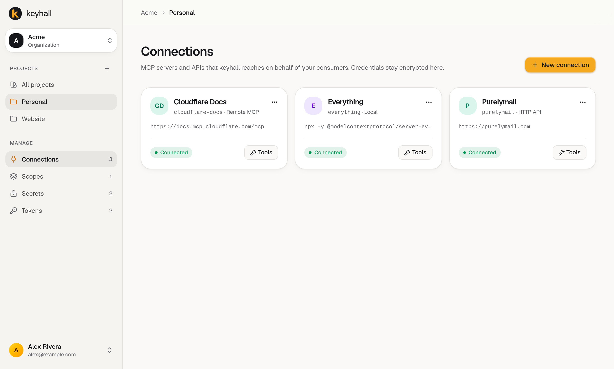
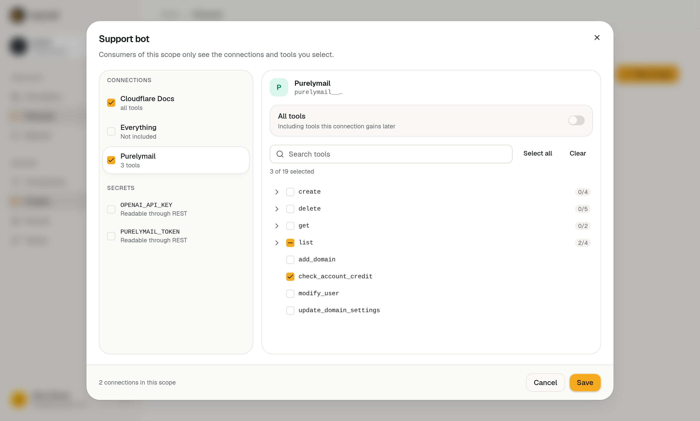
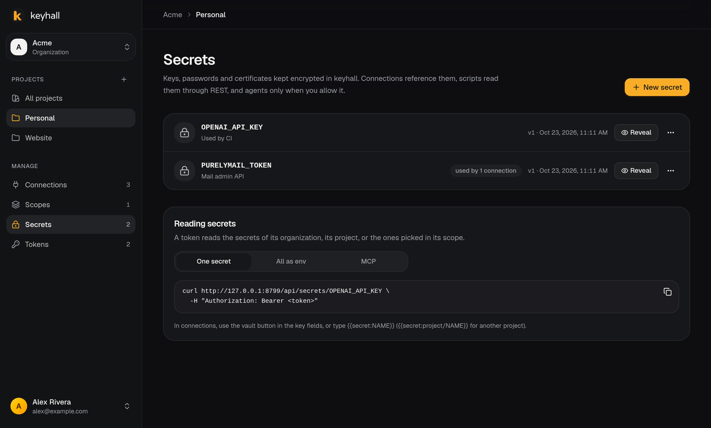

<p align="center"></p>

<h1 align="center">keyhall</h1>

<p align="center">
  <strong>One door to every MCP server, API and secret your agents use.</strong><br>
  Self-hosted. Credentials stay encrypted inside; each consumer gets a token that sees only what it needs.
</p>

<p align="center">
  <a href="https://github.com/luizgustavosaraiva/keyhall/actions/workflows/ci.yml"></a>
  <a href="https://github.com/luizgustavosaraiva/keyhall/actions/workflows/security.yml"></a>
  <a href="https://scorecard.dev/viewer/?uri=github.com/luizgustavosaraiva/keyhall"></a>
  <a href="https://github.com/luizgustavosaraiva/keyhall/releases/latest"></a>
  <a href="https://github.com/luizgustavosaraiva/keyhall/pkgs/container/keyhall"></a>
  
  
  
  <a href="LICENSE"></a>
</p>

<p align="center"></p>

## Why

Every agent and every machine ends up with its own copy of every API key, its own OAuth login to
every MCP server, and access to all of their tools. keyhall puts them in one place:

- **Connect once.** Remote MCP servers (with OAuth), local MCP servers started by command (paste
  the same `mcpServers` JSON you'd give Claude Desktop or Cursor), and any HTTP API, turned into
  MCP tools from its OpenAPI spec.
- **Hand out narrow tokens.** A token reaches a whole organization, one project, or a scope with
  hand-picked connections and tools, e.g. "the support bot may only *list* mail domains".
- **One endpoint.** Every consumer uses `https://<your-keyhall>/mcp`. Revoke one token without
  touching the others.
- **Keep secrets in a vault.** Reference them from connections (`{{secret:STRIPE_KEY}}`), load
  them in scripts and CI through REST, or let agents read them through MCP when you allow it.
  Every read is logged.
- **Encrypted at rest.** AES-256-GCM, with the key outside the database. Consumers never see an
  upstream credential.

<table>
  <tr>
    <td></td>
    <td></td>
  </tr>
</table>

## Quick start

Requires Docker with Compose. See [requirements](docs/requirements.md): 512 MB of RAM is enough.

```bash
mkdir keyhall && cd keyhall
base=https://raw.githubusercontent.com/luizgustavosaraiva/keyhall/main/deploy
curl -fsSLO $base/docker-compose.yml
curl -fsSL $base/.env.example -o .env
sed -i "s|^BETTER_AUTH_SECRET=.*|BETTER_AUTH_SECRET=$(openssl rand -base64 32)|" .env
sed -i "s|^KEYHALL_ENCRYPTION_KEY=.*|KEYHALL_ENCRYPTION_KEY=$(openssl rand -base64 32)|" .env
docker compose up -d
docker compose logs keyhall      # copy the setup code
```

Open <http://localhost:8787>, enter the setup code and create your account, then follow
**[Getting started](docs/getting-started.md)**.

> [!IMPORTANT]
> Save `KEYHALL_ENCRYPTION_KEY` from `.env` in a password manager. Without it, nothing stored in
> keyhall can be decrypted, not even from a backup.

Then connect a client:

```bash
claude mcp add --transport http --scope user keyhall https://<your-keyhall>/mcp \
  --header "Authorization: Bearer kh_..."
```

## Deploy

| Where | Guide |
|---|---|
| Your own computer | [Docker → own computer](docs/deploy/docker.md#3a-on-your-own-computer) |
| Any VPS, with automatic HTTPS | [Docker → Caddy](docs/deploy/docker.md#3b-on-a-server-with-https-from-caddy) |
| Behind nginx, Traefik, Dokploy, Coolify… | [Docker → existing proxy](docs/deploy/docker.md#3c-behind-a-proxy-or-platform-you-already-have) |
| Without Docker (Node.js + systemd) | [From source](docs/deploy/from-source.md) |
| Private, only for your devices (optional) | [Tailscale](docs/deploy/tailscale.md) |

Releases follow [Semantic Versioning](https://semver.org). Images are tagged `X.Y.Z`, `X.Y` and
`latest`; pin `X.Y` to get fixes without surprises. See [operations](docs/operations.md) for
upgrades, backups and key rotation.

## Documentation

- [Getting started](docs/getting-started.md): from install to an agent calling tools
- [Concepts](docs/concepts.md): organizations, projects, connections, scopes, tokens, secrets
- [Requirements](docs/requirements.md) and [configuration](docs/configuration.md)
- [Deploy](docs/deploy/docker.md) and [operations](docs/operations.md)
- [API reference](docs/api.md): MCP endpoint, secrets REST, proxy, health
- [Security model](docs/security.md)
- [Architecture](docs/architecture.md), for contributors

## Contributing

Issues and pull requests are welcome. Read [CONTRIBUTING.md](CONTRIBUTING.md) first; it covers the
development setup, the checks CI runs, and the contribution terms. Please report vulnerabilities
privately, as described in [SECURITY.md](SECURITY.md). Changes are listed in the
[changelog](CHANGELOG.md).

## License

[PolyForm Noncommercial 1.0.0](LICENSE). Free for personal use, research, education, and
noncommercial organizations. **Commercial use requires a separate license** from the author:
open an issue or reach out through [GitHub](https://github.com/luizgustavosaraiva).
